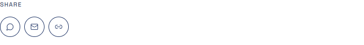
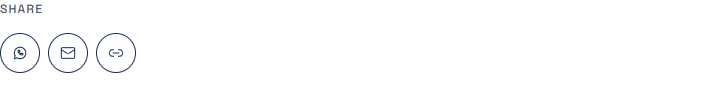
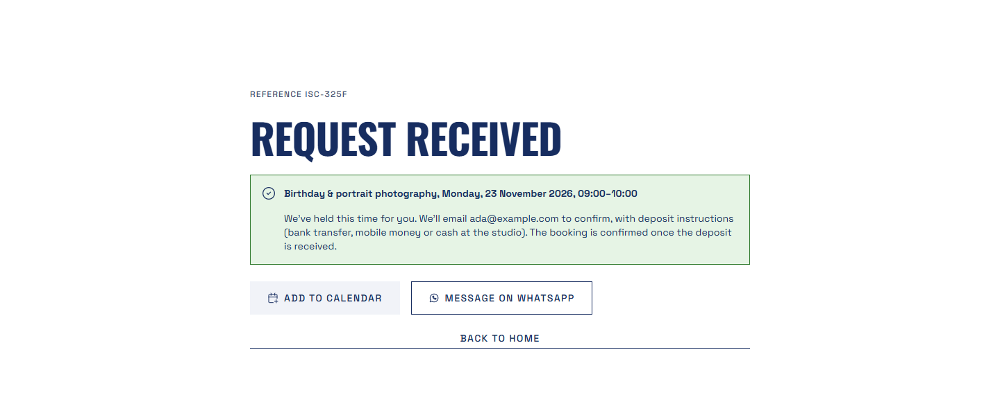

# Phase 1 verification summary

**Status:** provisionally accepted by the owner on 2026-11-21, pending final visual verification.
**Branch:** `redesign/design-system`. Draft PR #1 is not to be merged without the owner's approval.
**Design source of truth:** the approved iShot Concept design system (`design-system/`, synced into `src/styles/ds/`).

## Review previews (Vercel, behind Vercel login, preview target only)

| Deployment | Commit | Status |
|---|---|---|
| `lbmvj4229`: https://ishot-concept-prototype-lbmvj4229-philipbargins-projects.vercel.app | `50e60f4` | **Latest.** Its file hashes match the local build of `50e60f4`. |
| `lbv7fljde`: https://ishot-concept-prototype-lbv7fljde-philipbargins-projects.vercel.app | `0eff339` | Kept at the owner's request. Don't delete it until the owner approves. |

## The four owner corrections

| # | Correction | Status | Commit | Components |
|---|---|---|---|---|
| 1 | Remove the oversized "iShot" footer wordmark; keep the official logo | Done | `379d4e7` | `Footer.jsx`, `index.css` |
| 2 | Fewer, balanced footer links (Studio / Book / Visit, 3 each); removed links still reachable | Done | `379d4e7` | `Footer.jsx`, `index.css` |
| 3 | Testimonials and Founder/CEO sections, following the design-system Home template, with labelled placeholders | Done, with placeholders | `379d4e7` | `Testimonials.jsx`, `Founder.jsx`, `Home.jsx`, `src/prototype/sampleContent.js` |
| 4 | Instagram, Facebook and WhatsApp only, with one consistent icon set | Done | `379d4e7`, `50e60f4` | `SocialLinks.jsx` (`socials`, `BrandIcon`), `data.js`, `Article.jsx`, `Book.jsx` |

Related accepted change: header, hero and footer content aligned to the page container (`0eff339`).

### WhatsApp icon corrections (`50e60f4`): before and after

**Journal article "Share" row**

**Booking confirmation ("Request received")**

## Tests completed (latest run on `50e60f4`)

- Front-end build and design-token lint (`npm run build`): pass.
- **axe** (WCAG 2.1 A/AA + best practice): 0 violations across 10 pages × 375 / 768 / 1440 × light / Night (60 runs).
- No horizontal overflow and no console errors at any of those widths or themes.
- **Alignment:** header, hero, footer and legal-band content edges equal the main container edges at 1920 / 1440 / 768 / 375, in light and Night, on Home, About and Creative direction (24 of 24 checks). Backgrounds stay full width.
- **Social links:** header, menu sheet, footer and Contact show exactly Instagram, Facebook and WhatsApp with accessible names. Facebook is inactive (not focusable, announced as "link not added yet").
- **Journeys:** booking success; booking conflict, with focus kept on the Confirm step after choosing an alternative; contact form validation; My bookings; manage booking (awaiting deposit, locked/confirmed, invalid link). All unchanged.
- **CI on draft PR #1:** front-end build + tokens, PHPCS + PHPStan level 6, PHPUnit (WordPress + MySQL): all pass.

## Remaining limitations

- **Placeholder content is visible by design.** Testimonials, the founder profile and other sample content carry on-page notices. WordPress publishes testimonials only when the client has consented, and hides the section if there are fewer than 3.
- **Facebook** shows as an inactive icon until the page URL is supplied.
- **WhatsApp** links to the studio phone number from the brand brief (0881405259, +231). Nobody has confirmed yet that this number is on WhatsApp.
- **WhatsApp and Facebook icons** are line-style versions drawn to match the design system's icon set; they aren't the official brand artwork.
- **Testing environment:** the prototype was tested in headless Chrome only. Real-device, screen-reader and OS-level reduced-motion checks (B1–B3 in `docs/outstanding-acceptance.md`) are still open, and must pass on the WordPress front end before launch.
- **Optional accessibility refinements A1/A2** (menu link numbers, mobile booking-bar label) are still open and not yet authorised.
- The React app is a review prototype. The production site will be the WordPress theme and the booking plugin. Phase 3b/3c have not started and await the owner's authorisation.

## Outstanding content checklist (owner to supply; nothing here may be invented)

| Item | Needed | Where it appears now | Status |
|---|---|---|---|
| Facebook page URL | The full public page URL | Facebook icon in header, menu, footer, Contact (inactive) | ☐ Not supplied |
| WhatsApp number | Confirm 0881405259 (+231), or give the correct number | WhatsApp icon, article share, booking "Message on WhatsApp" | ☐ Not confirmed |
| Founder/CEO: name | As it should appear publicly | Home: Founder section (placeholder "Founder's name") | ☐ Not supplied |
| Founder/CEO: job title | e.g. "Founder & CEO" | Home: Founder section (placeholder title) | ☐ Not confirmed |
| Founder/CEO: biography | 60–100 words | Home: Founder section (placeholder text) | ☐ Not supplied |
| Founder/CEO: portrait | High-resolution photo, 4:5 crop possible | Home: Founder section (4:5 placeholder frame) | ☐ Not supplied |
| Testimonials | At least 3: client name or initials, session type, quote (15–40 words in their own words), **recorded consent**, optional rating | Home: Testimonials section (3 placeholder cards, no ratings) | ☐ Not supplied |

The full content inventory, covering services, prices, hours, policies, photography and hosting, is in `docs/content-inventory.md`.
